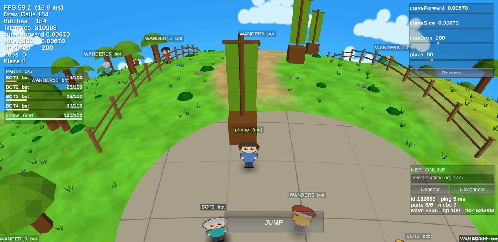
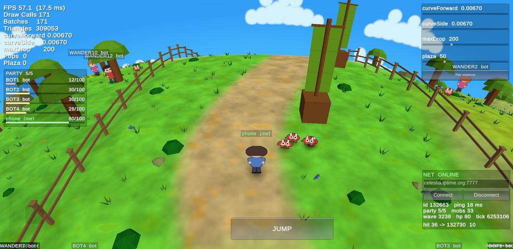
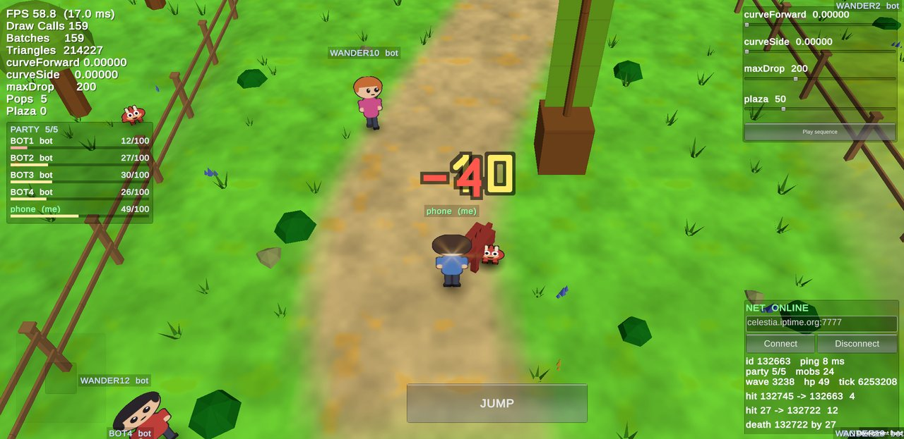
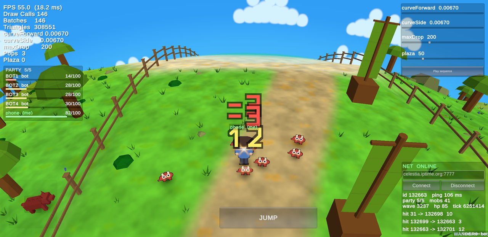
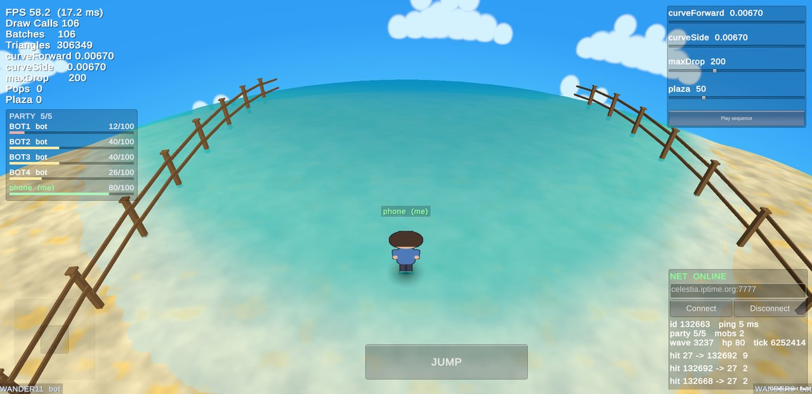
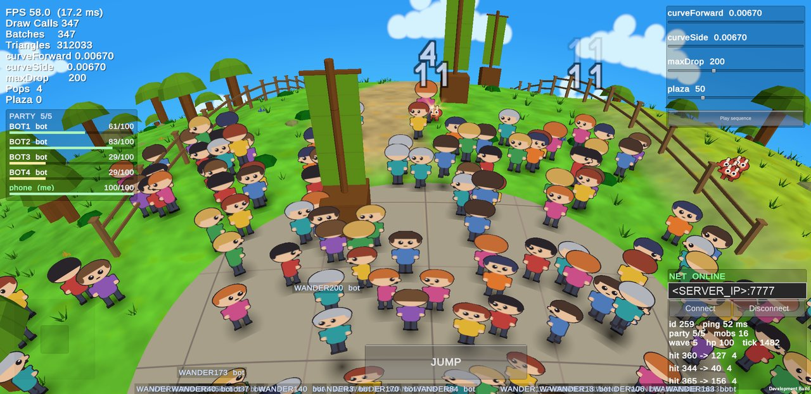

# Ever Planet PoC — 곡면 행성 월드 온라인 테크 데모

넥슨 **'에버플래닛'** 이 보여 줬던 “작은 행성 위를 걷는” 곡면 월드를
모바일(Android)에서 다시 구현해 본 기술 검증(PoC) 빌드입니다.
**원작 에셋은 한 건도 사용하지 않았고**, 화면의 모든 아트는 코드로 생성한 대체물입니다.

> 이 저장소에는 **실행 파일(APK)만** 공개합니다. 소스 코드는 포함하지 않습니다.

---

## 다운로드 · 설치

1. 오른쪽 **[Releases](../../releases/latest)** 에서 `everplanetpoc-*.apk` 를 내려받습니다.
2. Android 설정에서 브라우저(또는 파일 앱)의 **“출처를 알 수 없는 앱 설치”** 를 허용한 뒤 설치합니다.
3. 앱을 실행하고 오른쪽 아래 **NET 패널의 `Connect`** 를 누르면 온라인 서버에 접속합니다.
   서버 주소는 미리 입력되어 있습니다.

- 요구 사양: **Android 8.0 이상**, ARM64 기기
- 온라인 서버는 개인 장비에서 운영합니다. 점검·네트워크 사정으로 접속이 안 될 때가 있을 수 있으며,
  이 경우에도 오프라인으로 월드를 둘러볼 수 있습니다.

### 조작

| 입력 | 동작 |
|---|---|
| 왼쪽 아래 가상 스틱 | 이동 |
| `JUMP` | 점프 (구조물 위로 올라갈 수 있음) |
| 몹에 접근 | 자동 공격 (서버 판정) |
| 오른쪽 위 슬라이더 | 곡률 값을 실시간으로 조절 (`curveForward`/`curveSide` 를 0 으로 두면 평면) |

화면의 FPS·드로우콜 표시와 슬라이더는 성능과 곡률을 직접 확인할 수 있도록 일부러 남겨 둔 개발용 HUD입니다.

---

## 스크린샷 (Galaxy S8 실기 캡처)

| 곡률 켬 | 곡률 끔 (같은 장소) |
|---|---|
|  |  |

| 몹 웨이브 전투 | 북쪽 해안 — 수평선 너머로 휘어 넘어가는 바다 |
|---|---|
|  |  |

부하 측정: 봇 200여 명을 광장에 모은 상태. 한 화면 약 150명에서 FPS 58, 드로우콜 347.

---

## 무엇을 검증했나

### 1. 곡면 월드 — “월드는 평면, 곡률은 렌더링에서만”
- 지형·충돌·서버 좌표는 모두 **평면**으로 두고, 정점 셰이더에서 카메라와의 거리 제곱에 비례해
  지면을 아래로 내려 **행성처럼 보이게** 합니다(`drop = A·d² + B·s²`).
- 게임 로직과 서버는 곡률을 전혀 몰라도 되므로 구조가 단순하고, 곡률 값 하나로 행성 크기감을 바꿀 수 있습니다.
- 지평선 너머로 넘어간 지형 청크는 곡률을 반영해 그리지 않습니다(컬링).
- 월드 크기 400 × 300 — 광장, 흙길 3갈래, 다리, 점프로 오르는 구조물, 북쪽 해안과 바다, 하늘·구름.

### 2. 서버 권위 온라인
- 자체 서버(Python)가 **초당 20회 시뮬레이션, 초당 10회 상태 전송**. 이동·공격·데미지·사망·부활을 모두 서버가 판정합니다.
- **5인 파티** + 파티 밖 필드 유저 구조. 몹 웨이브와 보스가 주기적으로 등장합니다.
- 클라이언트는 서버 상태를 보간하고 내 캐릭터는 예측 이동해, 네트워크 지연이 있어도 끊김 없이 움직입니다.
- 화면에 보일 범위의 대상만 보내는 **관심 영역(AOI) 필터**로 동시 접속 확장에 대비했습니다.

### 3. 저사양 모바일 성능 (Galaxy S8, 2017년 출시 기기)

| 상황 | FPS | 드로우콜 |
|---|---|---|
| 평상시 필드 | 약 60 | 106 ~ 184 |
| 한 화면 약 100명 | 55 ~ 59 | 290 ~ 304 |
| 한 화면 약 150명 | 58 ~ 59 | 315 ~ 347 |

| 서버 동시 접속 (CPU 코어 1개 기준) | 50명 | 100명 | 200명 | 400명 |
|---|---|---|---|---|
| CPU 사용률 | 8% | 15% | 32% | 73% |

### 4. 원작 에셋 0건
- 텍스처와 메시는 전부 코드로 생성하며, 제작 파이프라인의 검증 단계가 외부 에셋 반입 여부를 자동 검사합니다.
- IP 라이선스를 받게 되면 원작 아트·캐릭터로 교체해 원작의 분위기를 복원하는 것이 다음 단계입니다.

---

## 기술 스택

Unity 6 (URP) · C# · Android IL2CPP/ARM64 · Python 3 asyncio 서버 (TCP, 줄 단위 JSON)

## 면책

이 프로젝트는 **넥슨 및 '에버플래닛'과 공식적인 관련이 없는 개인 테크 데모**입니다.
원작의 이미지·모델·사운드 등 에셋을 포함하지 않으며, '에버플래닛' 및 관련 상표는 각 권리자의 소유입니다.
